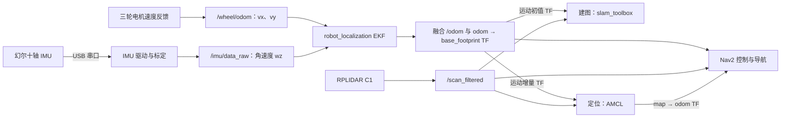

# AlohaMini 幻尔十轴 IMU 融合方案（待实施）

编写日期：2026-10-13。硬件已确认：幻尔十轴 IMU，通过 USB 串口连接。
实施进度：独立 USB 读取与验证已落地为 [alohamini_imu](../ros2_ws/src/alohamini_imu/README.md)，
参考本地例程提取协议与单位换算，启动时只读实际配置，不写入设备参数。本文的 EKF、
安装 TF 和建图／导航融合仍为待实施方案。
本方案基于仓库现有 ROS 2 Humble、三轮全向底盘、RPLIDAR C1、slam_toolbox 和 Nav2。
已按用户提供的本地资料修订：CH340X、Hiwonder 变长串口协议、默认 115200／100 Hz，
配套 ROS 2 Humble `imu_usb`。实际固件、当前保存的配置及安装姿态仍需在接入时核对。
详细差异和资料勘误见[本地教程对照](research/imu-local-manual-comparison.md)。

**推荐先实现：轮速提供前后／横向速度，IMU 提供转动角速度，由 robot_localization 的
EKF 输出统一的融合里程计，建图与导航共用这份结果。**

## 1. IMU 的数据用在哪里

轮子告诉系统“轮子转了多少”，IMU 告诉系统“车身实际怎样转动”，激光雷达通过周围
墙面等环境约束机器人在地图中的位置。三者互相补充。

| 数据 | 在本项目中的用途 | 第一阶段是否融合 |
|---|---|---|
| 底盘轮速换算的 `vx`、`vy` | 估计前进、后退和横移速度，再积分出平面位移 | 是，保留两个方向 |
| IMU 陀螺仪 `angular_velocity.z` | 估计车身转动速度，积分更新局部航向 | 是，核心输入 |
| IMU 姿态／四元数中的 yaw | 有可靠航向参考时进一步约束航向 | 后续评估 |
| IMU roll、pitch | 观察安装姿态、震动及倾斜；未来坡面功能可使用 | 平面 EKF 不融合 |
| IMU 加速度 | 可供运动诊断；经过标定和重力处理后才考虑融合 | 暂不融合 |
| 磁力计 | 支持模块内部航向解算，容易受电机、金属和电流影响 | 暂不把磁航向作为定位依据 |
| 气压／高度 | 官方十轴模块包含气压计，与当前室内平面导航无直接关系 | 不融合 |
| C1 激光扫描 | slam_toolbox 建图，或 AMCL 在已有地图中定位；同时供代价地图使用 | 保持现有激光链路 |

转向误差会影响随后整段路径。例如航向偏差 5° 时，沿错误航向走 5 m，单由这个角度
就会产生约 44 cm 的侧向误差。因此先改进转动测量，通常比直接用加速度推算位置更有价值。

IMU 在这里通过融合里程计间接参与建图和导航：

- 建图：更准确的相邻时刻运动估计，为激光匹配提供更好的初始位姿，尤其有助于转弯和轮子打滑时的朝向估计。
- 定位：AMCL 从 TF 获取融合后的局部运动增量，再用地图与激光更新全局位置。
- 导航：Nav2 的控制器等组件使用融合后的速度和 TF，有助于跟踪路径、转向和判断是否到达目标。

这些是预期收益，需要实物对照验证。低成本陀螺仪存在零偏，纯角速度积分仍会漂移；
第一阶段也不能直接纠正横向打滑造成的平移误差。全局位置和长期航向仍依赖激光环境约束。
相关组件行为见[官方资料核对](research/imu-fusion-primary-sources.md)。

## 2. 项目当前状态

| 环节 | 仓库现状 | 接入 IMU 时的含义 |
|---|---|---|
| 推荐的 ros2_control 路线 | 底盘控制器直接发布 `/odom` 和 `odom → base_footprint`，未启动 EKF | 需要插入融合层并移交 TF 发布权 |
| 可选 ZMQ 路线 | 已有 `/wheel/odom → EKF → /odom` | 可以复用结构，但当前 EKF 只有轮速输入 |
| EKF | `two_d_mode: true`，融合轮速 `vx/vy/wz` | 增加 IMU 配置，第一阶段使用轮速 `vx/vy` 与 IMU `wz` |
| 底盘 | 三轮全向，支持横移 | 不可照搬差速车的 `vy = 0` 约束 |
| 激光 | C1，默认 10 Hz，使用前方 180° 的 `/scan_filtered` | 继续作为建图、定位和障碍物观测来源 |
| SLAM | slam_toolbox，`do_loop_closing: false` | IMU 不会自动带来回环闭合 |
| Nav2 | AMCL 已使用 `nav2_amcl::OmniMotionModel`，配置的里程计话题为 `/odom` | 保持全向运动模型和统一输出接口 |
| 坐标系 | 导航基准为 `base_footprint`；CAD 的 `base_link` 默认另有 +90° yaw 旋转 | IMU 外参必须按整条 TF 链核对 |
| 依赖 | 已声明并在安装文档中安装 `robot_localization` | 不需要替换导航技术栈 |

本地依据：
[控制器配置](../ros2_ws/src/alohamini_base_control/config/controllers.yaml)、
[原生传感器入口](../ros2_ws/src/alohamini_bringup/launch/sensors_ros2_control.launch.py)、
[ZMQ 传感器入口](../ros2_ws/src/alohamini_bringup/launch/sensors_bridge.launch.py)、
[现有 EKF](../ros2_ws/src/alohamini_bringup/config/ekf.yaml)、
[SLAM 配置](../ros2_ws/src/alohamini_bringup/config/slam_toolbox.yaml)、
[Nav2 配置](../ros2_ws/src/alohamini_bringup/config/nav2_params.yaml)。

## 3. 推荐数据链路



建图运行 slam_toolbox，已有地图导航运行 AMCL；同一时刻只由其中一个发布 `map → odom`。
当前 slam_toolbox 和 AMCL 的这条使用方式不要求它们直接订阅 IMU。

目标 TF 树：

```text
map
└── odom                 ← 建图由 slam_toolbox 发布；定位由 AMCL 发布
    └── base_footprint   ← 仅 EKF 发布
        └── base_link   ← 现有固定变换，注意 CAD 轴向
            ├── laser_frame
            └── imu_link  ← 新增固定外参，刚性安装在底盘上
```

`/wheel/odom` 是原始轮速里程计，保留供 EKF 和诊断使用；`/odom` 是融合结果，供下游使用。
原始轮速里程计仍可包含它自己的积分位置，但第一阶段 EKF 只取其中 `vx/vy`。
禁止底盘与 EKF 同时发布 `/odom` 或同一条 `odom → base_footprint` TF。
不把 EKF 的输出重新作为它的输入，也不在本阶段把 AMCL／SLAM 的全局位姿反馈进局部 EKF。

## 4. 幻尔 IMU 的接入方式

采用“IMU 插树莓派 USB，驱动运行在树莓派 ROS 2 容器内”的方式，与底盘和 C1 位于
同一台主机。PC 继续用于 RViz。无需为这条 USB 串口链路增加 ESP32 或 micro-ROS。

以 `/home/yigeoooo/Downloads/10轴IMU惯导模块` 内的产品简介、通信协议和树莓派教程
为接入依据。它们描述的十轴模块包含陀螺仪、加速度计、磁力计和气压计，USB 转串口
使用 **CH340X**，默认 **115200 bps、100 Hz**，支持 1～250 Hz。115200 波特率下协议
限制最高 125 Hz；230400 及以上才允许 250 Hz。

本地教程明确使用 Ubuntu 22.04／ROS 2 Humble，提供 `imu_usb` 包并发布 `/imu/data_raw`。
该源码已支持参数配置、协方差和正确的单位换算，优先复用并修整它。此前网上找到的
CP2102／WIT／Foxy 示例与本地资料不匹配，其重复换算等缺陷不适用于当前这份驱动。
接入前需要修复本地驱动的缓存重发、无效字段和配置确认，并关闭其默认动态 TF。
证据见[本地教程对照](research/imu-local-manual-comparison.md)和[驱动核对](research/imu-local-driver-review.md)。

接入顺序：

1. 按本地教程校准并保存，确认实机发送 `55 55` 协议；读取当前配置，特别是量程和输出频率。
2. 将本地 `imu_usb` 作为实现基础，补齐新帧触发发布、过期检查、配置响应／读回验证及断线处理。
3. 使用 USB 序列号或物理端口生成 `/dev/imu_usb` 固定别名，与本地例程一致。IMU 和 C1 都可能成为 `/dev/ttyUSB*`，不能依赖插入顺序或仅按通用 USB 芯片绑定。
4. 确认树莓派容器内可访问该设备；上位机调试软件与 ROS 驱动分时使用，避免同时读串口。
5. 使用统一 launch 显式传入 `device_type=10axis`、量程、频率、标定开关与 `publish_tf=false`；机器人 URDF 独立提供固定安装外参。

建议以 115200 bps、100 Hz IMU、现有 25 Hz 轮速发布、30 Hz EKF 起步。默认加速度
量程 4G、带宽 48.3 Hz；陀螺仪量程 1024 dps、带宽 32.6 Hz。读回确认实际配置后再
验证有效运动帧频率，不能以反复发布缓存形成的 ROS 话题频率代替实测采样率。
验收后再决定是否将 EKF 提升到 50 Hz。上位机教程关于默认 125 Hz／0.2～200 Hz 的
文字与产品及协议冲突，方案采用产品默认表、协议编码表和本地 launch 相互印证的值。

主动上报格式为 `55 55 ID N DATA SUM`，配置与响应为 `55 AF ID N DATA SUM`，均为
小端数据；校验是前面所有字节累加取低 8 位。`0x03` 的 14 字节 DATA 同时含加速度、
角速度和陀螺仪温度，总帧长 19 字节。原始运动值是 LSB，需要当前量程确定比例：
默认量程下加速度除以 8192 后乘 9.80665，角速度除以 32 后乘 π/180。
协议 PDF 个别示例的校验字节有误，必须按规则生成并检查配置响应，不能直接照抄。

ROS 数据契约：

- 发布 `sensor_msgs/msg/Imu`，第一阶段约定 `/imu/data_raw`，`header.frame_id = imu_link`。
- 角速度统一为 `rad/s`，加速度统一为 `m/s²`。厂商若输出 `°/s` 或 `g`，在驱动中转换。
- 对未提供的姿态，按消息规范设置 `orientation_covariance[0] = -1`；不要伪造一个可信的零姿态。
- 角速度协方差应反映实际测量不确定性，单位为 `(rad/s)²`；全零表示协方差未知，不能据此假设完美测量。
- 如果模块另有经过验证的姿态输出，可额外发布 `/imu/data`，第一阶段 EKF 仍只使用角速度。
- 检查驱动与 EKF 的 QoS 兼容，确保“话题能看到”也对应“EKF 实际收到并采用”。

串口解析应检查帧边界、长度、校验和与数据有效性；分包、粘包时恢复同步。加速度和
角速度同在 `0x03` 帧，四元数在 `0x02` 帧，应分别记录新鲜度，不能把旧字段当成新测量。
采用新收到的 `0x03` 帧触发第一阶段 IMU 发布；没有新运动数据时停止重发并报告超时。
若缺少有效四元数，不能发布带有效协方差的默认单位四元数。保留模块内部 `9axis` 算法
并不意味着 EKF 也使用了磁航向，是否融合姿态由 EKF 掩码决定。
实现时用已知字节帧校验量纲、正负号与校验和，用分包／粘包样例验证解析恢复；再以
真实静止重力值和已知角度旋转检验输出，防止代码内部自洽却使用了错误比例。

接入资料与源码索引见[本地教程对照](research/imu-local-manual-comparison.md)。网上另一套
资料仅保留为[来源辨别记录](research/imu-fusion-primary-sources.md)，不作为本模块的协议依据。

## 5. 第一版融合配置草案

下面是**待实施的参数草案**，并非当前已启用的配置。建议新增 `ekf_imu.yaml`，保留
现有只使用轮速的 `ekf.yaml` 作为对照和明确选择的备用模式。

```yaml
ekf_filter_node:
  ros__parameters:
    use_sim_time: false
    frequency: 30.0
    sensor_timeout: 0.2
    two_d_mode: true
    publish_tf: true
    print_diagnostics: true

    map_frame: map
    odom_frame: odom
    base_link_frame: base_footprint
    world_frame: odom

    # 顺序：x y z | roll pitch yaw | vx vy vz | vroll vpitch vyaw | ax ay az
    odom0: /wheel/odom
    odom0_config: [false, false, false,
                   false, false, false,
                   true,  true,  false,
                   false, false, false,
                   false, false, false]
    odom0_queue_size: 5
    odom0_differential: false
    odom0_relative: false

    # 假定 imu_link 的 Z 轴与底盘竖直轴一致；其他安装姿态需调整配置并验证 TF。
    imu0: /imu/data_raw
    imu0_config: [false, false, false,
                  false, false, false,
                  false, false, false,
                  false, false, true,
                  false, false, false]
    imu0_queue_size: 10
    imu0_differential: false
    imu0_relative: false
    imu0_remove_gravitational_acceleration: false
```

启动 EKF 时将其 `odometry/filtered` 输出重映射为 `/odom`。
`imu0_remove_gravitational_acceleration` 在这里保持关闭，因为加速度根本没有参与融合。
仅融合角速度不需要先加 Madgwick/Mahony 姿态滤波器，也不需要打开 `imu0_differential`。

这一版选择轮速 `vx/vy` 与 IMU `wz`，便于先量化 IMU 的收益。后续可以将实测轮速 `wz`
也纳入 EKF，通过合理协方差融合两个角速度来源。不要把同一套轮速积分出的 yaw、位置
和速度全部当成独立证据；也不要默认模块姿态与模块陀螺仪完全独立。

现有控制器的 `twist_covariance_xy: 0.20`、`twist_covariance_yaw: 0.35` 是配置值，
尚不能视为针对当前地面的实测标定结果。调试时需结合静止、直行、横移和旋转记录重新评估。
纯静止噪声方差也不足以代表行驶时震动、轮滑和温漂造成的误差。

## 6. 标定与时序是实施重点

**坐标与安装。** IMU 固定在底盘刚性结构上，优先靠近旋转中心，避免装在会转动的头部、
升降机构或机械臂上。位置靠近中心对后续使用加速度尤其有利。尽量让模块 Z 轴朝上。
测量并记录 `base_link → imu_link` 的平移和旋转，由 URDF 发布一次固定 TF。

项目以 `base_footprint` 的 X 前、Y 左、Z 上为导航约定，俯视逆时针转动应得到正 `wz`。
`base_link` 是 CAD 坐标，不可直接假定与导航坐标重合；xacro 中部分历史注释与默认角度
描述不一致，应以运行时 TF 和实物转动验证为准。配置掩码对应输入传感器坐标轴，若模块
侧装，不能仅复制上面的 Z 轴选择。若未来用姿态，另外核对 ENU/NED 和四元数定义，不能
只改 `frame_id` 来冒充坐标转换。

**陀螺仪零偏。** 本地教程要求先通过上位机完成标定和保存，正常运行的 launch 默认
关闭陀螺仪和气压自动校准。协议中的出厂默认则是开启上电校准；直接运行节点的默认值
也与 launch 不同，项目必须显式传参。若选择上电自动校准，应保持静止至少 2～3 秒，
确认标定完成及数据恢复再允许运动；标定期间模块会暂停主动上报。不能沿用另一套网页
手册的静止阈值／持续自动调零假设。

完成设备标定与预热后，在底盘静止时采集约 30～60 秒，统计 `wz` 均值和方差，验证
温漂与慢转输出。需要额外软件校正时，只在可靠静止状态估计零偏，避免重复补偿。
robot_localization 的标准
15 状态滤波器没有独立的陀螺仪 bias 状态，不会自动完成这项标定。

**时间戳。** 本地协议的 `0x03` 运动帧没有设备采样时间字段，先用收到完整新帧的
主机时间，并记录串口传输延迟与抖动。不能读取一批积压帧后都当成“现在”的新测量，
也不能像当前示例一样，没有新运动帧时仍用 `now()` 给缓存数据重新打戳。
雷达、轮速与 IMU 时间戳应处在同一时钟域；回放时相关节点统一启用模拟时钟。

现有 `scan_sector_filter` 默认会对仍新鲜的扫描重新打戳。接入时应测量这一步带来的
时间偏移；若原始 C1 时间戳已正确，评估保留采集时间，以免快速转动时人为错开激光与
运动估计。该问题应单独验证，不能靠增大 TF 容忍时间掩盖。

## 7. 具体改动清单

| 文件／模块 | 拟做改动 |
|---|---|
| 接入并修整本地 `imu_usb` 包 | 复用正确协议和单位换算；修复缓存重发、缺失字段、配置确认、时间戳、断线处理；关闭动态 TF |
| `alohamini_description/urdf/alohamini_nav.urdf` | 增加刚性安装的 `imu_link` 及固定关节，供两种底盘入口共用 |
| `alohamini_base_control/launch/base_control.launch.py` | 增加控制器配置文件选择入口，使融合场景可以覆盖里程计话题和 TF 开关 |
| 融合专用的控制器配置 | 以现有配置为基础，设置 `odom_topic: /wheel/odom`、`publish_tf: false`；确保其他硬件参数一致 |
| 新增 `alohamini_bringup/config/ekf_imu.yaml` | 使用上面的第一版融合输入 |
| `sensors_ros2_control.launch.py` | 接入 IMU 驱动和 EKF，输出 `/odom`；使用融合专用控制器配置 |
| 共用的融合启动入口 | 建议抽出小型 launch，统一驱动、EKF、参数和输出重映射，供两套 sensors 复用 |
| 两种底盘的 mapping/navigation 启动入口 | 透传 IMU 开关、串口、波特率、EKF 配置等参数 |
| `scripts/alohamini_mapping_session` | 增加并透传对应参数，让现有键盘建图入口也可启用 IMU |
| `sensors_bridge.launch.py` | 复用现有原始里程计与 TF 结构，增加 IMU 输入和配置选择 |
| RViz、依赖与使用文档 | 加入原始／融合里程计对比，记录设备别名、标定、启动和验收方法 |

注意 ZMQ 建图会话当前强制传入 `use_commanded_yaw_for_odom:=true`。接入后不能把命令
转速当作独立实测角速度参加融合；使用该路线时应关闭这一替代，或确保该字段不被选入 EKF。

建议融合栈提供 `use_imu:=true/false`：开启时选新配置，关闭时用轮速 `vx/vy/wz` 的现有
配置作对照，两种模式都由同一个 EKF 负责 TF。上述入口和参数是拟新增内容，目前不可
直接当作已实现的启动命令使用。独立运行原有底盘控制器仍可使用其现有默认配置。

## 8. 分阶段验证与验收

| 阶段 | 工作 | 通过条件 |
|---|---|---|
| A：IMU 独立接入 | 模块静止、手动旋转、低速转动车身，检查报文和 ROS 消息 | 单位、方向、采样率、外参和时间戳正确；无连续断流或错误帧；获得零偏／噪声记录 |
| B：局部融合 | 先运行底盘、IMU、EKF，做直行、左右横移、正反向 90°/360° 转动 | `/odom` 和 TF 唯一且连续，横移没有被约束成零，旋转角误差优于轮速基线 |
| C：建图对比 | 同一路径多次采集，观察墙面重影、拐角和返回起点表现 | 有 IMU 时局部匹配稳定性改善；不会新增跳变、延迟或 TF 错误 |
| D：导航对比 | 在相同地图下重复同一组目标点，记录到点误差与转向修正 | 定位稳定，转向和路径跟踪至少不退化，并量化收益 |

建议每组运动重复至少 3 次，用地面标记、量角工具或外部观测作为参考。不要用融合里程计
自身充当真值。记录实际静止漂移、360° 旋转误差、直行／横移距离误差、时间延迟和导航
成功率；通过门槛在获得硬件基线后确定，不预先承诺厘米级精度。

对照实验可用同一份原始 rosbag 分别运行“只用轮速”和“轮速 + IMU”配置，避免手动
驾驶路径不同影响结论。采集建议包含 `/wheel/odom`、`/imu/data_raw`、`/scan`、
`/scan_filtered`、`/odom`、`/tf`、`/tf_static`、`/cmd_vel` 及诊断话题。
回放重算时要过滤旧的 `/odom`、`odom → base_footprint` 以及旧 SLAM／AMCL 的
`map → odom` 动态 TF，只保留需要的原始观测与机器人外参，避免旧结果与新结果争抢。

接入后可用下列命令做接口检查；它们不代表本方案已在实物执行：

```bash
ros2 topic hz /imu/data_raw
ros2 topic echo /imu/data_raw --once
ros2 topic info /imu/data_raw -v
ros2 topic info /odom -v
ros2 run tf2_ros tf2_echo base_footprint imu_link
ros2 run tf2_ros tf2_echo odom base_footprint
```

IMU 断流、时间回退和串口重连应有诊断。第一版只用 IMU 测 `wz`，断流后 EKF 可能继续
预测，这不等于自动改用轮速角速度；`sensor_timeout` 也不是自动切换开关。建议异常时
暂停导航并报告原因，检查恢复后再继续；需要备用模式时明确以只用轮速的配置重启验证。
不要在故障瞬间让底盘重新抢占 TF 发布权。

## 9. 后续增强的条件

- 若模块姿态在电机启停、机械臂运动和不同室内位置下都稳定，再评估增加 yaw 融合；六轴融合得到的 yaw 本身仍可能漂移。
- 若希望改善大范围地图返回起点的闭合误差，单独评估 slam_toolbox 回环参数。当前关闭回环，IMU 融合与开启回环是两项不同改动。
- 若高速转动仍有扫描畸变，单独评估扫描逐点时间与运动补偿；加入 EKF 不等于自动实现激光去畸变。
- 若需要明显坡度、三维运动或直接的激光惯性紧耦合，再评估合适的建图算法与传感器。当前 C1 二维扫描链路先完成上述方案，不需要为 USB IMU 接入更换整套 SLAM。

独立读取与验证的用法及实测记录见 `alohamini_imu` 包；本方案中的 EKF、安装 TF 和导航融合仍待实施。
